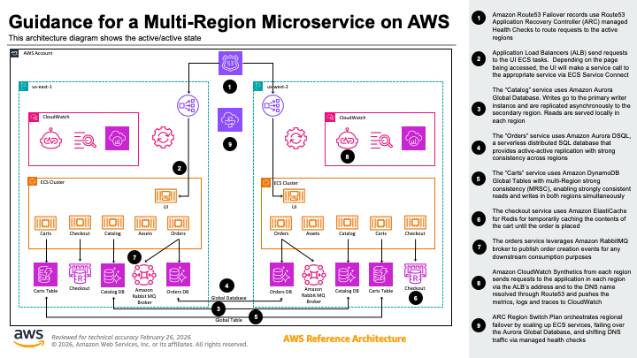
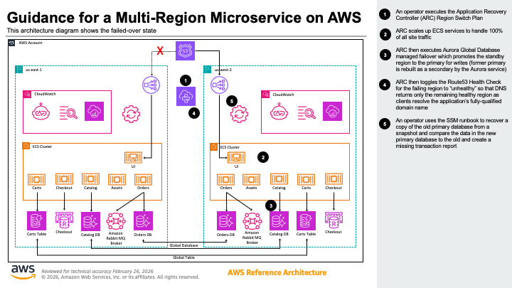
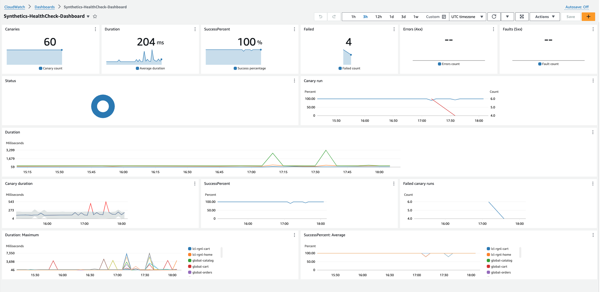
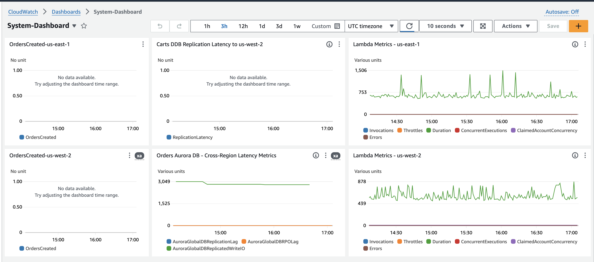

# Guidance for a Multi-Region Microservice on AWS

## Getting started

This guidance helps customers design and operate a multi-Region microservice based architecture for an e-commerce platform on AWS using services like Amazon Elastic Container Services (ECS), Amazon Aurora Global Database, Amazon Aurora DSQL, Amazon DynamoDB Global Tables with multi-Region strong consistency (MRSC), and Application Recovery Controller (ARC) Region Switch. The solution is deployed across two Regions in an active/active configuration where both regions serve traffic simultaneously. This is possible because all services except Catalog are either stateless or use globally strongly consistent datastores (Aurora DSQL for Orders, DynamoDB Global Tables with MRSC for Carts). The Catalog service uses Amazon Aurora Global Database, which is sufficient for active/active because catalog data is read in-region and updated infrequently by an external process (in the event of data loss due to failover, updates can be re-run). The solution leverages an ARC Region Switch Plan to orchestrate regional failover through an automated workflow that scales up ECS services in the target region, fails over the Aurora Global Database, and shifts DNS traffic via ARC-managed Route53 health checks.

## Application Overview

The sample application is an e-commerce platform. The front-end runs as a service in Amazon Elastic Container Service (ECS), supported by back-end microservices (catalog, assets, orders, carts, checkout) for displaying products, adding items to carts, and placing orders. The application uses Amazon Aurora Global Database for the Catalog service, Amazon Aurora DSQL for the Orders service, and Amazon DynamoDB Global Tables with multi-Region strong consistency for the Carts service.


## Architecture

### 1. Operating in the active/active state



1. Amazon Route53 Failover records use Route53 Application Recovery Controller (ARC) managed Health Checks to route requests to the active regions

2. Application Load Balancers (ALB) send requests to the UI tasks on Amazon Elastic Container Service (ECS).  Depending on the page being accessed, the UI will make a service call to the appropriate service via ECS Service Connect

3. The “Catalog” service uses Amazon Aurora Global Database. Writes go to the primary writer instance and are replicated asynchronously to the secondary region. Reads are served locally in each region.

4. The “Orders” service uses Amazon Aurora DSQL, a serverless distributed SQL database that provides active-active replication with strong consistency across regions.

5. The “Carts” service uses Amazon DynamoDB Global Tables with multi-Region strong consistency (MRSC), enabling strongly consistent reads and writes in both regions simultaneously.

6. The checkout service uses Amazon ElastiCache for Redis for temporarily caching the contents of the cart until the order is placed.

7. The orders service leverages Amazon RabbitMQ broker to publish order creation events for any downstream consumption purposes. The publish is best effort and runs off the request path, on a small bounded pool: with the broker down, orders are still saved and answered in time, and the events that can't be sent are logged and dropped.

8. Amazon CloudWatch Synthetics from each region sends requests to the application in each region via the ALB’s address and to the DNS name resolved through Route53 and pushes the metrics, logs and traces to CloudWatch.

9. Amazon Application Recovery Controller (ARC) Region Switch Plan orchestrates regional failover by scaling up ECS services, failing over the Aurora Global Database, and shifting DNS traffic via managed health checks.


### 2. Cross Region Failover 



1. An operator executes the Application Recovery Controller (ARC) Region Switch Plan

2. ARC scales up ECS services to handle 100% of all site traffic

3. ARC then executes Aurora Global Database managed failover which promotes the standby region to the primary for writes (former primary is rebuilt as a secondary by the Aurora service)

4. ARC then toggles the Route53 Health Check for the failing region to “unhealthy” so that DNS returns only the remaining healthy region as clients resolve the application’s fully-qualified domain name

5. An operator uses the SSM runbook to recover a copy of the old primary database from a snapshot and compare the data in the new primary database to the old and create a missing transaction report

The numbers label the diagram. The plan runs them in the order 1, 2, 4, 3: it moves DNS as soon as the remaining Region has scaled up, and switches the database over last. [Automatic failover and fail-back](#3-automatic-failover-and-fail-back) says why.

### 3. Automatic failover and fail-back

The Region Switch plan in [`deployment/failover.yaml`](deployment/failover.yaml) moves traffic away from a Region, and `make failback` brings the Region back.

**What the plan does when it deactivates a Region**, in this order:

1. It scales up the ECS services of the Region that stays, all six in parallel, to twice the highest count they reached in the last 24 hours (15 minutes allowed). For ui, the only service behind the load balancer, the step also waits until the new tasks pass the target group's health check, so DNS moves only onto tasks the load balancer sends requests to. The other five are reached through ECS Service Connect and have no target group, so there is nothing more to wait for.
2. It moves DNS. The plan's Route 53 health check for the Region goes unhealthy, so the application's name resolves only to the Region that stays (5 minutes allowed).
3. It switches the catalog database over. The writer of the Aurora global database moves to the Region that stays (10 minutes allowed). This is a switchover, which loses no data.

An operator starts it, at the Region that stays, because the Region being drained may be the impaired one:

```
aws arc-region-switch start-plan-execution --plan-arn <RegionSwitchPlanArn> --action deactivate \
  --target-region <Region to move away from> --mode graceful --region <the other Region>
```

> **Why traffic moves before the catalog database.** The failover plan moves traffic as soon as the healthy Region has scaled up, and only then switches the catalog database's writer to that Region. That order is acceptable because catalog is a low-write database. Shoppers only read it, and each Region reads from its own copy, so the healthy Region serves catalog pages without the writer. Its only writes are the schema and sample product data that the catalog service loads when it first starts, so nothing needs the writer during a failover. If a workload like this one does need to accept writes during an outage, it can queue them and apply them after recovery.
>
> The switchover loses no data. If it can't finish, for example because the primary database is down, the plan pauses with traffic already moved, and a person decides whether to retry it, skip it, or fail over with possible data loss. The automation never makes that trade on its own.

**If the switchover pauses the run.** The execution waits in the state `pausedByFailedStep`, and a paused execution holds the plan: a new execution and `make failback` both wait until a person resolves it. There are three ways out, and only the last can lose data:

- **Retry.** The API has no retry for a failed step. Once the database is healthy, cancel the paused execution (`aws arc-region-switch cancel-plan-execution`) and start the deactivate again. That repeats the scale-up too, which asks for more tasks the second time because ARC sizes it from the highest count of the last 24 hours (never past each service's maximum of 10). This path has not been tried on this sample.
- **Skip the step.** `aws arc-region-switch update-plan-execution-step --step-name switch-over-catalog-db --action-to-take skip --comment <why>` lets the run finish. The writer stays where it is. Each Region keeps reading its own cluster, so only catalog writes wait. `make failback` moves the writer to the primary Region once its database is available.
- **Switch the run to ungraceful.** `aws arc-region-switch update-plan-execution-step --step-name switch-over-catalog-db --action-to-take switchToUngraceful --comment <why>` fails the database over to the Region that stays, and can lose the catalog writes the old primary had not yet replicated. Choose it only when the primary database is not coming back soon and losing those writes is acceptable.

**Failing a Region back.** When the Region is healthy again, run:

```
make failback REGION=<Region>
```

`REGION` is required and must be on the command line. The command needs no Resilience Hub stack. It does these in order and stops where the next step depends on the last:

| Step | What it does |
|---|---|
| Preflight | Refuses, and lists every reason, unless the Region's own journey alarms and the other Region's view of it have been `OK` for 10 minutes, no plan execution is going or paused, and the plan's Route 53 health checks are not all unhealthy. It also refuses a Region that is serving while the other one is the Region DNS moved away from. |
| Activate | Starts the plan's activate workflow for the Region, graceful, at that Region's endpoint, and waits (10 minutes at most). A Region whose health check is healthy already is not activated again. If the execution fails, pauses or runs out of time, the command stops: capacity and the writer are left alone while DNS is in doubt. |
| Capacity | The failover scaled the remaining Region up and nothing scales it down again, so this sets every service's desired count and Auto Scaling minimum back to 2 in both Regions, the values `ecs.yaml` declares. The maximum is left as it is. |
| Writer | If the catalog writer is not in `PRIMARY_REGION`, switches the global database over to the cluster there, and waits for it. After a person chose to fail the database over, the old primary has to rejoin and catch up first, so this waits up to 45 minutes. If it has not by then the writer stays where it is, which is safe, and the command prints what to run to finish. |

Every step reads before it writes, so running the command again after a partial failure repeats nothing that is done. It exits 0 when done, 1 when a step failed, 2 when preflight refused (nothing was changed), and 3 when it finished except for what it says is left for you. The credentials need to read CloudWatch alarms, start and read plan executions, update ECS services and their Application Auto Scaling targets, and switch over the Aurora global database.

Activating the Region in the ARC console runs only the DNS step. It does not put the capacity back or move the writer, so use `make failback`.

**Service quotas in the Region that stays.** The plan compares the two Regions' quotas for what its scaling steps launch (such as Fargate vCPUs) within 30 minutes of being created or updated, and then once a day. A quota that is lower in one Region shows on the plan's Service quota warnings tab in the ARC console. A warning doesn't stop an execution, but the scale-up can fail when it reaches the lower quota. The execution role can read quotas and not request them, so ARC never files an increase, which would open a support case, on its own. To let it, add `servicequotas:RequestServiceQuotaIncrease` and `servicequotas:GetRequestedServiceQuotaChange` to the role, and `iam:CreateServiceLinkedRole` in an account that has never requested a quota increase.

**What plan evaluation shows.** ARC checks the plan against your resources several times an hour, and shows the result in the console and in `aws arc-region-switch get-plan-evaluation-status`. For this plan it reads `actionRequired`, with one warning naming `servicequotas:RequestServiceQuotaIncrease` and `servicequotas:GetRequestedServiceQuotaChange`, the two permissions the role leaves out. A warning that names any other permission is a gap in the role. Plan evaluation tests the reads a quota check needs for services on EC2 container instances even when every service runs on Fargate, as here, so the role has them too: `ecs:DescribeContainerInstances`, `ec2:DescribeInstances`, `ec2:DescribeLaunchTemplateVersions` and `autoscaling:DescribeLaunchConfigurations`. It also tests `ecs:DescribeTasks` on a task outside any cluster, so that grant covers every task in the two Regions, not only the two clusters' tasks. With these reads the role can see every EC2 instance, launch template and launch configuration in the account, including the user data in launch templates and launch configurations.

**Measurement and reports.** The plan has a recovery time objective of 10 minutes. ARC measures it from the start of an execution until the application health alarms, the `journey-global-*` alarms of both Regions, are green, and writes a report of each execution (the step timeline, the alarms' states and the recovery time against the objective) to the stack's reports bucket, named in the output `ReportsBucketName`, under `executions/`. Reports expire after 90 days. The plan also lists the other journey alarms (`journey-lcl-*`, `journey-rmt-*` and `region-degraded`) as trigger alarms.

**How long it takes, measured three times.** An operator-started deactivate of us-east-1 on a test deployment took 6 minutes 18 seconds, which ARC reported as the recovery time (objective: 10 minutes). The six scale-ups ran in parallel and ended after 65 seconds (ui) to 195 seconds (carts, the service that starts slowest, which sets the pace); moving DNS took 2 minutes, because the step waits for Route 53 to show the Region's health check as unhealthy; the switchover took 1 minute. That run had no failure to detect, so a failover that an alarm starts adds the 2 to 3 minutes the alarms need, and the time ARC takes from the alarms to the start of the plan, which is not published. Two failovers that the triggers started confirmed it: in the `catalog-recovery` run the plan started 2 minutes 52 seconds after the fault began (12 seconds after the last alarm condition was met) and took 6 minutes 48 seconds, so the four `journey-global-*` alarms were green again 8 minutes 18 seconds to 9 minutes 40 seconds after the fault began, and users of the DNS name saw errors for 6 to 7 minutes; the failover in the `cart-isolation` run took 5 minutes 57 seconds. `make failback` took 4 minutes: the activation 2 minutes, the capacity reset seconds, the switchover back 1 minute 19 seconds. Task size and start-up time set these numbers, so measure your own with `make ngrh-test TEST=catalog-recovery` or an operator-started deactivate. These runs predate the scale-up waiting for ui's health check. The target group counts a new ui task healthy after five passing checks 30 seconds apart (its defaults), about two minutes after the task starts, so ui now finishes around when carts did and the scale-up can take a little longer than measured here.

**What the switchover costs users.** The Region that gives up the database writer fails its catalog-backed journeys for about a minute: its catalog gets `connection refused` while the cluster there changes roles, then connects again on its own, without restarting a task. In the failover that Region is the one traffic has just left: the global journeys, which go through the DNS name as users do, stayed at 100%, but the Region's own canaries failed for that minute, and so did the other Region's canaries that test it. In the fail-back it is the Region that has been serving, and DNS already names both Regions again, so some requests to it failed for that minute. One bad minute does not meet an alarm's two-of-three rule, but two do: the canaries that test the Region from outside (`journey-rmt-*`) went into alarm for two minutes after the failover. That did not meet a trigger, because a trigger also needs the Region's own journey alarm (`journey-lcl-*`), and one bad minute did not raise it.

**What starts a failover.** While automatic failover is enabled (the default) the plan has eight alarm triggers, one for each Region and journey (home, cart, catalog, orders). The trigger for Region A and a journey starts when three things hold at once: the journey fails in A (`journey-lcl-<journey>` in A, A's canaries against A's own load balancer, is in alarm), the other Region B confirms it (`journey-rmt-<journey>` in B, B's canaries against A's load balancer, is in alarm), and B is healthy itself (`region-degraded` in B is `OK`). Each canary alarm needs two failed runs out of three one-minute runs, so a failure has to last about two minutes before it counts. Because B has to be healthy, an event that hits both Regions starts nothing, and because B has to agree, one broken observer starts nothing. A trigger starts a graceful deactivate of A, as the plan's execution role, and not more than once in 60 minutes. Nothing asks anyone first: a journey that stays down in one Region while the other Region is healthy fails that Region over, which is what the plan is for. Failing back is not automatic (`make failback`), and the automation never fails the database over with data loss: the switchover is the only database action the plan takes.

**The automatic-failover switch.** `make deploy AUTOMATIC_FAILOVER=disabled` (the default is `enabled`) leaves out the eight triggers and the permission that lets the plan's execution role start the plan, so only an operator starts an execution. An existing deployment changes with `make region-switch-plan AUTOMATIC_FAILOVER=disabled` (or `enabled`), which updates the plan stack in place after deploying again what the plan waits for (global routing and monitoring). Before arming the triggers on a deployment, run `make ngrh-alarm-replay`: it counts how often the triggers' conditions would have been met over the last 14 days, and any match means the journey alarms are noisier than the triggers can bear. The e2e workflow deploys with `disabled` so that an ordinary run can never fail over its own deployment, and with `enabled` only for the manual `catalog-recovery` run.


## Resilience Modeling with AWS Resilience Hub

The `make ngrh` target models this application in AWS Resilience Hub (`resiliencehubv2`) so its resilience can be assessed against explicit RTO/RPO targets. The model has three layers — **user journeys**, **services**, and **resiliency policies (tiers)** — described below along with the rationale for each mapping.

### User journeys → services

A *user journey* is a business-meaningful path through the application. Each journey depends on the ECS services that fulfill it:

| User journey | Services exercised |
|---|---|
| Browse Catalog | ui, catalog, assets, cart |
| Manage Cart | ui, cart |
| Checkout & Place Order | ui, checkout, orders, cart |
| View Orders | ui, orders, cart |

Notes:
* `ui` is the only public entry point (ALB + Route 53/ARC health checks) and fans out to the backends via ECS Service Connect, so it participates in every journey.
* `cart` participates in every journey too. The ui asks it for the cart on every page it renders (`BaseController.populateCommon` in `source/ui`), so a stalled cart service fails browsing and the order list as well as the cart and checkout pages.
* `checkout` orchestrates the order: it reads the cart and calls `orders` to create the order on submit (an inter-service dependency beyond the UI-centric hub-and-spoke diagram).
* Operational concerns (CloudWatch Synthetics canaries, the ARC Region Switch runbook) are **not** modeled as journeys — they are detection/recovery mechanisms, not user-facing paths.

### Resiliency policies (tiers)

Two policies express the resilience requirements. Each uses **one RTO/RPO bar applied across all disruption types** (AZ, hardware, software, Region); the per-disruption breakdown comes from the assessment, not from differentiated targets. A policy is attached to a service, not to a journey.

| Policy | RTO | RPO | Applied to services |
|---|---|---|---|
| **Tier-1** (zero data loss) | 10 min | 0 | ui, cart, orders |
| **Tier-2** (RPO-relaxed) | 10 min | 5 min | catalog, checkout, assets |

Justification:
* **The RTO is 10 minutes in both policies, the realistic Active/Active floor.** Resilience Hub treats ~10 minutes as the minimum achievable RTO for an Active/Active topology (failure detection + DNS TTL + connection drain + service stabilization). An aspirational 5-minute target is flagged as unachievable across every service, which drowns out the genuinely actionable findings; 10 minutes is the honest target and lets the real architecture gaps surface.
* **RPO 0 for Tier-1 is honest for the write path** because Orders uses Aurora DSQL and Carts uses DynamoDB Global Tables — strongly consistent across Regions. The only data lost in a regional failover is in-flight checkout session state in ElastiCache (not a system of record; the customer simply re-enters it).
* **Tier-2 relaxes the RPO to 5 minutes where the data is asynchronous or transient.** Catalog is a read path on Aurora Global Database (asynchronous replication), so a strict RPO 0 is not physically achievable there. This is an accepted compensating control rather than a defect: catalog data is read-only in-Region and written by an external, re-runnable ingest from an external system of record, so any unreplicated catalog updates are recovered by re-running ingest with no unrecoverable data loss. This rationale is recorded as a Resilience Hub **assertion** on the `catalog` service. Checkout keeps its session state in ElastiCache, which is not a system of record, and assets serves static files and holds no data.

### Which policy each service has

| Service | In journeys | Policy | Data |
|---|---|---|---|
| ui | all four | Tier-1 | none |
| cart | all four | Tier-1 | DynamoDB global table |
| orders | Checkout & Place Order, View Orders | Tier-1 | Aurora DSQL |
| catalog | Browse Catalog | Tier-2 | Aurora Global Database (asynchronous replication) |
| checkout | Checkout & Place Order | Tier-2 | ElastiCache (session state) |
| assets | Browse Catalog | Tier-2 | none (static files) |

The policy is set on each service in `deployment/ngrh.yaml`; it is not the strictest policy among the service's journeys. Catalog, checkout and assets take part in the Browse Catalog and Checkout & Place Order journeys and carry Tier-2.

### Region scope

The application is modeled as a single multi-Region system with `disasterRecoveryApproach = ACTIVE_ACTIVE` for both the multi-AZ and multi-Region targets — both Regions serve traffic and the data tier is strongly consistent (Aurora DSQL, DynamoDB Global Tables). ECS capacity that ARC scales up on failover is reflected as a contributor to recovery time (RTO), not as a different DR classification.

### How each service finds its resources

Each service discovers its resources by tag, not by CloudFormation stack. Its input source matches resources whose `service` tag is the service's own name or `shared`, and dependency discovery follows the connections from there.

The cart service has one more input source, the stack that creates the carts table (`carts-db-stack${ENV}`). The table is an `AWS::DynamoDB::GlobalTable`, and discovery by tag lists a global table's replicas as one plain `AWS::DynamoDB::Table` per Region, so only the stack makes discovery list the global table. That is the resource type the isolation test's DynamoDB pause acts on; without it the pause is skipped and the test never touches the table. `make ngrh` looks the stack up and passes its ARN as the template parameter `CartsDbStackArn`. If the stack doesn't exist the parameter is empty and the cart service discovers by tag alone. Run `make ngrh` again after the stack has been recreated, because its ARN changes.

* **Resources one service owns carry its name.** For example, the carts ECS service, its task definition, task role and ECR repository, the DynamoDB table and the cart alarms all carry `service=cart`.
* **Resources the whole application relies on carry `service=shared`**, for example the VPCs, the load balancer, global routing, the Region Switch plan and the alarms that watch every journey.
* **Where the tags come from:** stacks with a single owner, such as the databases, and fully shared stacks get the tag as a stack tag from the Makefile, which CloudFormation applies to every resource in the stack that supports tags. Stacks that mix owners (`apps`, the canaries, monitoring and the base infrastructure) tag each resource in the template.
* **The ECS cluster has no `service` tag.** All six services run on it, so tagging it would make every service discover all the others through the cluster.

This narrows each service's assessment to its own resources and the shared ones. For example, catalog's assessment no longer covers checkout's Redis, which stack discovery included because every service listed the `apps` stack.

**Upgrading a deployment that already has the model.** Changing a service's input sources in place doesn't change what Resilience Hub has already discovered for it, so recreate the services:

1. Run `make deploy` so the application's resources carry the tags.
2. Run `make destroy-ngrh`, then `make ngrh`. Deleting the stack also empties its report bucket, so download any reports you want to keep first.
3. Wait at least 4 hours for discovery to settle before running assessments. Expect different findings, because each service now covers fewer resources.

### Running Resilience Hub tests

The `ngrh` stack also creates the two IAM roles a Resilience Hub test run executes as:

* **`ngrh-invoker${ENV}`** is each service's invoker role. Besides the assessment policy it carries `AWSResilienceHubResilienceTestingPolicy`, which lets Resilience Hub create, start and stop the AWS FIS experiment behind a test run. Without it every test run fails at `fis:CreateExperimentTemplate`. When the deployment uses an AWS DevOps Agent Agent Space it also carries permissions for it ([Investigating with AWS DevOps Agent](#investigating-with-aws-devops-agent)).
* **`ngrh-test-experiment${ENV}`** is the role to choose as the test's IAM role. FIS assumes it to inject the faults, and it carries the permissions the FIS actions reference lists for every action in the four Resilience Hub test templates (Availability Zone recovery, dependency validation, multi-Region isolation, multi-Region recovery). Only FIS experiments in this account can assume it.

People running tests do not need to create IAM roles. They need `iam:PassRole` on these two roles (passed to `resiliencehub.amazonaws.com` and `fis.amazonaws.com`) and pick them when they create a test.

Faults on ECS tasks (`aws:ecs:task-network-packet-loss`, used by the dependency validation and both multi-Region templates) need three things in the task definition ([requirements](https://docs.aws.amazon.com/fis/latest/userguide/ecs-task-actions.html#ecs-task-requirements)), and every task definition in this sample has them:

* **An SSM agent sidecar** (`amazon-ssm-agent`, non-essential). It registers the task as an SSM managed instance tagged with the task's ARN, which is how FIS finds the task. The task subnets have no internet route, so the sidecar runs an image built into your account's ECR (`amazon-ssm-agent<ENV>`) from `deployment/ssm-agent-sidecar.Dockerfile`, with the commands it and the FIS fault documents run baked in. `make mirror-sidecar-images` builds it on a first deployment, and the weekly repave rebuilds it, checking each of those commands in the new image before it replaces the one your tasks pull. A bare SSM agent image in its place starts a sidecar that exits at once (no `aws`, no `ps`), no task registers with SSM, and Resilience Hub's ECS faults then fail with "At least one ECS Task is not registered as a SSM managed instance".
* **`pidMode: task`**, so the sidecar can reach the application's processes.
* **`enableFaultInjection: true`**, which turns on the ECS fault-injection endpoints that FIS network faults use on Fargate.

Each task role can create the sidecar's SSM activation and pass the managed-instance role to SSM, and nothing else is added to it. ECS Exec stays off, because FIS can't run these actions on a task that has it enabled.

**Upgrading a deployment that already has the weekly repave.** The repave's commands are part of its stack, and it clones `main` for the files they read. Run `make self-update` once the sidecar is on `main`; a repave still running the older commands would copy the bare SSM agent image over the sidecar's image, because it mirrors every public image the sidecar buildspec names. After that, `make mirror-sidecar-images` (or the next repave) rebuilds the image, and the service's tasks need replacing to pick it up. A live `make ngrh-test-preflight` says which tasks aren't registered with SSM.

### Investigating with AWS DevOps Agent

This part is optional. Resilience Hub can hand a failure mode assessment finding, or a test run, to [AWS DevOps Agent](https://docs.aws.amazon.com/devopsagent/latest/userguide/) to investigate, once a service is connected to an Agent Space. The sample creates the Agent Space and gives Resilience Hub access to it, and leaves the connecting to you, because it costs money:

```
make devops-agent
```

This deploys the stack `devops-agent${ENV}` (`deployment/devops-agent.yaml`) in the primary Region. It creates:

* an Agent Space, `multi-region-microservice${ENV}`, with elevated actions off, so the agent analyses and recommends but takes no action in your account;
* the role DevOps Agent assumes to investigate your account, `devops-agent-space${ENV}`, with the managed policy AWS documents for it, `AIDevOpsAgentAccessPolicy`. That is mostly read access, and it also allows `cloudtrail:StartQuery` and `support:CreateCase`;
* the role behind the Agent Space's operator web app, `devops-agent-operator${ENV}`, with `AIDevOpsOperatorAppAccessPolicy`;
* the association that lets the Agent Space investigate this account. It finds the account's resources in every Region, so one Agent Space serves both of the sample's Regions.

If the NGRH model is deployed, `make devops-agent` then runs `make ngrh`, which finds the stack and gives the invoker role `ngrh-invoker${ENV}` the inline policy `ResilienceHubDevOpsAgentAccess`. If it is not deployed yet, `make ngrh` does this when you run it. The policy has the eight actions Resilience Hub calls: `GetAgentSpace`, `GetOperatorApp` and `ListAssociations` to check the connection, and `CreateBacklogTask`, `GetBacklogTask`, `UpdateBacklogTask`, `ListExecutions` and `ListJournalRecords` to start, follow and cancel an investigation. They apply to this one Agent Space. The policy in the AWS documentation allows any Agent Space (`agentspace/*`); the template does not, and it refuses an ARN with a wildcard in it. The invoker role does not get `AIDevOpsAgentFullAccess` or `AIDevOpsOperatorAppAccessPolicy`, which the documentation says Resilience Hub must not have because they include actions that change an Agent Space.

Nothing is connected yet, so no investigation has started. **Connecting a service is a separate step, because it starts paid work.**

**Connecting starts one investigation for every finding.** When a service is connected, Resilience Hub starts a DevOps Agent investigation for each failure mode finding the service has, open or resolved, all at once. DevOps Agent runs three at a time and queues the rest, and bills each by the agent-second. The Resilience Hub pages about DevOps Agent do not say this. In a test deployment, connecting `orders` (21 findings) started 21 investigations within four seconds, and the six services of this sample had 111 findings between them. Those investigations ran for 6 to 40 minutes each by the clock. `aws devops-agent get-account-usage` shows the month's investigation hours, and the pricing page below says what is billed. A test run of a connected service starts one more.

```
make devops-agent-status
make devops-agent-connect DEVOPS_AGENT_SERVICES="orders"
```

`make devops-agent-status` shows each service's connection and how many findings it has, which is how many investigations connecting it starts. `make devops-agent-connect` refuses unless you name the services (`ui`, `catalog`, `cart`, `checkout`, `orders`, `assets`, or `all`), and before it changes anything it prints each service's finding count and the total. Start with one service. A service already connected to the Agent Space is left alone and starts nothing. A connection that fails, for example because IAM has not yet added the new policy, is reported once with Resilience Hub's reason and is not sent again; run the command again for it when the cause is fixed. Findings change as you assess and fix things, so the count can differ from run to run.

Once a service is connected, a test run of it starts an investigation, and each of its failure mode assessment findings offers **Chat with DevOps Agent**.

**In one command.** `make deploy DEVOPS_AGENT_CONNECT="orders"` deploys the sample and then does the two steps above: `make devops-agent`, and `make devops-agent-connect` for the services named. It takes the same names as `DEVOPS_AGENT_SERVICES`, and `all` means every service. Without the variable `make deploy` does neither, and the `e2e` workflow does not set it. Before it deploys anything it checks the names and that your AWS CLI is 2.38.0 or later, so a typo or an old CLI is found at once and not after the deploy. The Agent Space and the connection come last, after the NGRH model is deployed, and the step waits a minute between them (`DEVOPS_AGENT_IAM_WAIT`, in seconds) for IAM to give the invoker role its new policy, because a connection that cannot use the policy yet is not sent again. Like the separate command, it prints each service's finding count before it connects. `make deploy` runs no assessment, so the count is whatever the services already have: on a deployment that has been assessed, naming `orders` starts as many investigations as it has findings, so name one service first. With `DEVOPS_AGENT_SPACE_ARN=<arn>`, an Agent Space you made yourself, the Agent Space stack is not created and the services connect to yours. If the connection fails, the deploy is done and nothing is lost: fix the cause and run `make devops-agent-connect` as above.

The operator web app is at the address `aws devops-agent get-operator-app --agent-space-id <AgentSpaceId> --query operatorAppUrl` prints; the `AgentSpaceId` is an output of the stack.

**What you need.**

* A primary Region where DevOps Agent is available ([Supported Regions](https://docs.aws.amazon.com/devopsagent/latest/userguide/about-aws-devops-agent-supported-regions.html)). The Agent Space is created there.
* AWS CLI 2.38.0 or later, the first version that can connect a service. The tool checks and says so if yours is older.
* Permission to create IAM roles and pass them to DevOps Agent, and to administer DevOps Agent. The managed policy `AIDevOpsAgentFullAccess` has every DevOps Agent action the stack uses and no IAM actions, so add those. The e2e role in `deployment/github-oidc-role.yaml` has both: the IAM actions in `IAMForCFN`, and the DevOps Agent actions in `DevOpsAgentSpace`, which is limited to this account's Agent Spaces in us-east-1 and us-west-2.

**If the first deploy fails.** AWS's own template notes that creating an Agent Space right after its roles can fail while IAM catches up. A failed first deploy leaves the stack in `ROLLBACK_COMPLETE`. Run `make destroy-devops-agent`, then `make devops-agent` again.

**Cost.** DevOps Agent bills the time the agent spends working, $0.0083 per agent-second, for investigations, chat and custom agents, and its [pricing page](https://aws.amazon.com/devops-agent/pricing/) says there is no charge while the agent is idle. That page works an 8-minute investigation out at about $4. Connecting a service starts one investigation per finding (above), and every test run of a connected service starts one more, so a connected deployment pays for each on top of the test's own cost. `aws devops-agent get-account-usage` shows the month's investigation hours so far. An Agent Space also starts a task of its own, "system learning", with no service connected: in one test account it began about 33 minutes after the Agent Space was created, ran for 22 minutes, and the usage command counted it as `monthlyAccountSystemLearningHours`; in another test account, an Agent Space left up for about two hours counted 27 minutes of it. The pricing page lists no charge for it, so check your usage if you leave an Agent Space running. Paid AWS Support plans get monthly DevOps Agent credits, which the pricing page explains.

**Which Agent Space `make ngrh` uses.** In this order:

1. `DEVOPS_AGENT_SPACE_ARN`, when you set it, even to nothing. This is how to use an Agent Space you made yourself, in the console for example: `make ngrh DEVOPS_AGENT_SPACE_ARN=arn:aws:aidevops:<Region>:<account-id>:agentspace/<agent-space-id>`.
2. The Agent Space of the `devops-agent${ENV}` stack, when that stack exists.
3. None. The stack keeps what it has, so a deployment that never used DevOps Agent is not touched. `make deploy` runs `make ngrh`, so the deploy step of the `e2e` workflow gets this case and creates no Agent Space; the workflow's own step for that comes after the tests (next paragraph).

**In the `e2e` workflow.** After the tests, and before the teardown, the step `Deploy the DevOps Agent Agent Space` runs `make devops-agent`. It shows that the stack deploys with the e2e role (the `DevOpsAgentSpace` statement of `github-oidc-role.yaml`) and that CloudFormation accepts the invoker role's policy on the NGRH stack. It connects no service, so no investigation starts, and it only calls CloudFormation, so the runner's AWS CLI does not need to be 2.38.0. It comes last because of the system learning task under **Cost**: the teardown's `make destroy-all` deletes the NGRH stack and then the Agent Space within minutes of its creation, and a run that failed earlier never reaches the step. A fork whose e2e role was created before this step existed has to deploy `github-oidc-role.yaml` again first, or the step fails with `AccessDenied`.

**Taking it away.** `make devops-agent-disconnect` takes every service off the Agent Space. `make ngrh DEVOPS_AGENT_SPACE_ARN=` (set to nothing) disconnects the services and removes the invoker role's access. `make destroy-devops-agent` deletes the stack, and with it the Agent Space and its investigations and chat history, for good; it refuses while the NGRH stack still uses the Agent Space. `make destroy-all` deletes the NGRH stack first and then the Agent Space, and `make destroy-ngrh` disconnects the services before it deletes them. That disconnect is best effort: on an AWS CLI older than 2.38.0, which cannot see whether a service is connected, `make destroy-ngrh` prints that it skipped it and goes on, so a deployment that made its Agent Space and connected nothing tears down cleanly. A service you connected by hand stays connected until you disconnect it. `make devops-agent-disconnect`, which you ask for, still refuses an old AWS CLI.

### Testing resilience with NGRH

The tests live in [`deployment/ngrh-tests.json`](deployment/ngrh-tests.json), not in CloudFormation: Resilience Hub has no test resource, and creating a test twice is an error, so a small tool (`python3 -m ngrh_testing`, standard library only, run from `deployment/`) reads the file and makes Resilience Hub match it. Each test says which service it faults, which template it uses, what to block, which alarms decide the verdict, and what result the sample is expected to give. [`docs/ngrh-test-ground-truth.md`](docs/ngrh-test-ground-truth.md) explains each expectation. The first test, `orders-broker-dependency`, blocks orders' traffic to its Amazon MQ broker for 15 minutes. The second, `catalog-recovery`, drops catalog's traffic to its database in us-east-1 for 20 minutes and passes when the plan's alarm triggers (see [Automatic failover and fail-back](#3-automatic-failover-and-fail-back)) have moved the traffic to us-west-2 within the multi-Region objective of 10 minutes. It really fails us-east-1 over. The third, `cart-isolation`, cuts us-east-1 off from us-west-2 for 30 minutes and asks whether us-east-1 keeps serving on its own; it is expected to fail, and when it does the triggers fail us-east-1 over.

Run them after `make deploy`, `make monitoring` and `make ngrh`:

| Command | What it does |
|---|---|
| `make ngrh-tests` | Creates each test that doesn't exist and updates one that differs from the spec, then makes its alarm sources match. Safe to repeat: a test that matches is left alone, and nothing is ever deleted. It stops before writing anything if a reference doesn't resolve, an alarm or template doesn't exist, or a service has two tests for one template. |
| `make ngrh-test-preflight [TEST=<name>\|all] [MODE=live\|static]` | Lists every reason a run should not go ahead, or says all checks passed. `MODE=static` checks only the configuration (roles, tests, alarms exist, the service can take the fault); the default `live` also checks the alarms are `OK` and that no test run, FIS experiment or plan execution is active. Exits 2 when refused. |
| `make ngrh-test TEST=<name> [ALARM_WAIT=<minutes>] [SETTLE_WAIT=<minutes>] [FAILBACK=auto\|skip]` | Runs the live preflight, starts the run, follows it until it ends (the test's duration plus 20 minutes at most), waits `SETTLE_WAIT` minutes (default 10) so the alarms' recovery is in the report, and writes it. `ALARM_WAIT` first waits up to that many minutes for the test's success and stop alarms to have data, which a new deployment's alarms don't until its canaries have reported. This injects a real fault into the deployed sample. Exits 0 when the verdict is the expected one and 3 when it isn't, including when the fault never ran (a verdict of `INCONCLUSIVE`). If the Region Switch plan deactivated a Region during the run, `FAILBACK=auto` (the default) then waits up to 30 minutes for that Region to have been healthy for ten, runs `make failback` for it and adds the result to the report; `FAILBACK=skip` leaves the Region deactivated and prints the command. |
| `make ngrh-test-stop TEST=<name> [STOP_WAIT=<minutes>]` | Asks the test's active run to stop, and with `STOP_WAIT` waits up to that many minutes for it to end. |
| `make ngrh-test-report TEST=<name> [RUN=<id>]` | Collects a run's report again (the latest run by default), for example after a run you did not watch. |

A run cannot start while any Resilience Hub service in the account has an active run, so tests that share resources never overlap, and a tester's own run on another service counts too.

A test's success and observability alarms must be alarms Resilience Hub discovered for that service, which it finds by the service's tag input sources (orders: `service` is `orders` or `shared`). An alarm tagged for another service, such as `hop-checkout-errors` (tagged `checkout`), is refused by `StartTestRun` with "alarms not discovered for this service", however recent the assessment. Preflight reads the service's input sources and each source alarm's tags and refuses before the run starts; put such an alarm in `evidenceAlarms`, which the report reads from alarm history without Resilience Hub's involvement.

**The recovery and isolation tests need the plan's triggers.** `catalog-recovery` and `cart-isolation` are the two tests with an eighth preflight check, because either can end with the plan failing a Region over, and the live preflight refuses them unless the plan has a trigger that deactivates the Region the test impairs or isolates (a deployment made with `AUTOMATIC_FAILOVER=disabled` has none), the plan's last execution started more than the triggers' delay (60 minutes) ago, and scaling up us-west-2 to the percentage the plan asks for, over the highest task count each service had in us-east-1 in the last 24 hours, stays within the service's maximum. The static preflight leaves the check out, so a deployment with the switch off still passes it. Besides Resilience Hub's verdict the recovery run has a check of its own, `deactivate-completed`: a deactivate of the impaired Region must have started during the run and ended `completed`. Without it a run could pass because the fault did not bite, or because a person moved the traffic by hand. The report lists the plan's executions during the run with each step and ARC's own recovery time against the objective. Run `make ngrh-alarm-replay` first, to see whether the triggers would have fired on the last days of real traffic.

**The isolation test shows whether a Region keeps serving when it is cut off.** `cart-isolation` runs the multi-Region isolation template on the cart service for 30 minutes. FIS blocks the routes, Transit Gateway peering and VPC endpoints that lead from us-east-1 to us-west-2, and pauses S3 and DynamoDB global table replication (and MemoryDB's, where there is a multi-Region cluster). The test gives no `dependencies`: Resilience Hub's documentation says an API caller supplies them explicitly (the console's pre-selection does not apply to one), so no DNS name should be dropped as well. The template's own parameter text says the list is "auto-populated from dependency discovery if enabled", which the first run showed not to apply to an omitted list (the report's "Dependencies blocked" section was empty). Which of these actions run depends on what Resilience Hub's discovery lists for the cart service, and the report's "What the fault reached" section says what it reached. In test2 the first run reached three subnets and nothing else: discovery by tag lists the carts table as two plain DynamoDB tables, not as a global table, so the DynamoDB pause was skipped and the run `PASSED` where the ground-truth page expects `FAIL`. With the table's stack as a second input source (above) the second run reached the table as well. That page has both runs. Its success alarms are us-east-1's four local journeys, `journey-lcl-*`, which go through the Region's own load balancer and never leave it, so a Region that can serve alone keeps them `OK`. Its stop condition is `region-degraded` for us-east-1: FIS ends the fault when one of those journeys fails. The test is judged also by two run checks, which decide a run that Resilience Hub passed and are listed in the report of any run: `no-plan-execution` (no plan execution started during the run) and `destination-stayed-ok` (`region-degraded` in us-west-2 stayed `OK`, because us-west-2 is where us-east-1's users would go).

The sample is expected to fail this test. The carts table is a multi-Region strong consistency table. While FIS pauses its replication, the replica in the isolated Region answers writes and strongly consistent reads with HTTP 500 errors, and only eventually consistent reads still work ([AWS Database Blog: Best practices for Amazon DynamoDB Global Tables, Part 3](https://aws.amazon.com/blogs/database/best-practices-for-amazon-dynamodb-global-tables-part-3-validating-regional-resilience-with-aws-fault-injection-service/)). Carts reads with strong consistency, and every page of ui asks carts for the cart, so all four local journeys fail in us-east-1, a few minutes after the pause begins (FIS says replication can go on for up to five minutes after an action starts). The stop condition then ends the fault, and the triggers, which need us-east-1's own journey red, us-west-2's view of it red and us-west-2 healthy, fail us-east-1 over. In test2 the second run did this: it ended `FAILED` after 6.8 minutes, as expected, the stop condition ended the fault at 11:49:38, and a trigger started the failover two minutes later, because the table kept returning errors for two minutes after the stop and the alarms lag the fault. Because the stop condition ends the fault about two minutes after users first see errors and a failover takes about six minutes, this test cannot show whether the plan restores service while a fault goes on; `catalog-recovery` has no stop condition and is the test for that. A run that ends `PASSED` would contradict this, and [the ground truth page](docs/ngrh-test-ground-truth.md) says what to look at in the report. When the plan did deactivate us-east-1 during the run, `make ngrh-test` fails it back as it does after `catalog-recovery`.

If your terminal drops or you press Ctrl-C, the run carries on in AWS: nothing is stopped for you. The tool prints the two commands to use later, `make ngrh-test-stop` and `make ngrh-test-report`.

**In GitHub Actions**, every run of the `e2e` workflow creates the tests and runs the static preflight once the deploy has finished (the steps `Reconcile NGRH tests` and `Check NGRH tests (static preflight)`), so a change that breaks a test's references fails the pull request. No fault is injected. Every run deploys with `AUTOMATIC_FAILOVER=disabled`, because a journey that fails in one Region while the other is healthy, as it can while a deployment is still coming up, would otherwise fail the deployment over before the smoke test; only a run started by hand with `catalog-recovery` or `cart-isolation` chosen deploys with it `enabled`. To run a fault test there, start the workflow by hand (Actions, then `e2e`, then Run workflow) and choose a test in `ngrh_test`; the default, `none`, runs none. The job waits up to 15 minutes for the test's alarms to have data, runs the test after the smoke test and before teardown (waiting ten more minutes after the run, so the report has the alarms' recovery), and attaches the report to the run as the `ngrh-test-reports` artifact, also when the test fails. When the plan deactivated a Region during the run, which `catalog-recovery` expects and `cart-isolation` causes when a journey fails in the isolated Region, `make ngrh-test` fails the Region back itself, so the teardown starts with both Regions active. The step fails when the verdict isn't the expected one. The job's limit is six hours, the most GitHub allows for a hosted runner, and a run without a fault test uses about four. `catalog-recovery` adds the wait for alarm data (up to 15 minutes), the 20-minute fault, the settling and the fail-back, about an hour more when nothing goes wrong, so about five hours and a quarter against the limit; `cart-isolation` adds the same pieces around a fault of up to 30 minutes (its stop condition ends it as soon as a journey fails in the isolated Region), so it fits too; a job that times out does not finish its teardown, and the deployment then stays in the CI account until someone runs `make destroy-all` for it. If the job is cancelled while a run is going, a last step asks it to stop and waits up to 10 minutes, because teardown deletes the tests and refuses while a run is active. Resilience Hub discovers the resources of a new deployment over the hours after it is created, so a fault run on a fresh deployment may reach fewer targets than one on a deployment that has been up a while: the report lists the targets it reached.

**The report** is written to `deployment/ngrh-test-reports/<test>-<run>.md` with the full data beside it as `.json` (the directory is not committed). It starts with the verdict against the expectation, then what Resilience Hub watched and each alarm's outcome, a timeline, the targets the fault reached and the dependencies it blocked. It also shows the state changes of alarms Resilience Hub doesn't watch, laid out by hop: both Regions' `region-degraded`, then ui and each back-end in turn. That layout is how you trace a journey that failed to the service behind ui that caused it. A run that ends `ERROR` carries no message when the invoker role was denied a call: look for `AccessDenied` in CloudTrail around the start time.

`make destroy-ngrh` deletes the tests before the stack, because deleting a service that still has tests is not documented to work. It refuses while a run is active.


## Pre-requisites

* To deploy this example guidance, you need an AWS account (We suggest using a temporary or a development account to 
  test this guidance), and a user identity with access to the following services:

    * AWS CloudFormation
    * Amazon Virtual Private Cloud (VPC)
    * Amazon Elastic Compute Cloud (EC2)
    * Amazon Elastic Container Services (ECS)
    * Amazon Relational Database Service (RDS)
    * Amazon ElastiCache for Redis
    * Amazon Aurora Global Database 
    * AWS Identity and Access Management (IAM)
    * AWS Secrets Manager
    * AWS Systems Manager
    * Amazon Route 53
    * AWS Lambda
    * Amazon CloudWatch
    * Amazon Simple Storage Service
    * Amazon Application Recovery Controller
    * AWS DevOps Agent (optional, only for [Investigating with AWS DevOps Agent](#investigating-with-aws-devops-agent))

* Install the latest version of AWS CLI v2 on your machine, including configuring the CLI for a specific account and region
profile.  Please follow the [AWS CLI setup instructions](https://github.com/aws/aws-cli).  Make sure you have a 
default profile set up; you may need to run `aws configure` if you have never set up the CLI before. 

* Install Python version 3.12 on your machine. Please follow the [Download and Install Python](https://www.python.org/downloads/) instructions.

* Install `make` for your OS if it is not already there.

* Install `zip` for your OS if it is not already there (used to package source for AWS CodeBuild). Container images are built via AWS CodeBuild — no local Docker installation is required.

### Regions

This demonstration by default uses `us-east-1` as the primary region and `us-west-2` as the backup region. These can be changed in the Makefile.

## Deployment

For the purposes of this workshop, we deploy the CloudFormation Templates via a Makefile. For a production workload, you'd want to have an automated deployment pipeline.  As discussed in this 
[article](https://aws.amazon.com/builders-library/automating-safe-hands-off-deployments/?did=ba_card&trk=ba_card), a multi-region pipeline should follow a staggered deployment schedule to reduce the blast radius of a bad deployment.  
Take particular care with changes that introduce possibly backwards-incompatible changes like schema modifications, and make use of schema versioning.


## Configuration
Before starting deployment process please update the following variables in the `deployment/Makefile`:

**ENV** - It is the unique variable that indicates the environment name. Global resources created, such as S3 buckets, use this name. (ex: -dev)

**PRIMARY_REGION** - The AWS region that will serve as primary for the workload

**STANDBY_REGION** - The AWS region that will serve as standby or failover for the workload

## Deployment Steps

We use make file to automate the deployment commands. The make file is optimized for Mac. If you plan to deploy the solution from another OS, you may have to update few commands.

1. Deploy the full solution from the `deployment` folder
    ```shell
    make deploy
    ```

## Verify the deployment

**Deployment Outputs**

Verify deployment outputs after a successful deployment. If you are deploying the solution to **us-east-1** a sample deployment output will look like this:- 

Canaries:
* https://us-east-1.console.aws.amazon.com/cloudwatch/home?region=us-east-1#synthetics:canary/list
* https://us-west-2.console.aws.amazon.com/cloudwatch/home?region=us-west-2#synthetics:canary/list

Region Switch Plan:
* Use `aws arc-region-switch start-plan-execution` to initiate failover

**Optional Windows clients (diagnostics only)**

Windows EC2 clients for in-VPC browser testing are **not** deployed by default.
If you need them for diagnostics, deploy them in both regions with:

```bash
make client ENV=<env>
```

This prints the Fleet Manager console links and the Administrator password
secret locations for each client. `make destroy-all` still cleans them up if
they were deployed.

## Observability

Each Region is provisioned with a CloudWatch dashboard that shows the healthchecks as reported by the Synthetic Canaries in each Region. 



In addition, a System Dashboard is also provisioned that shows key metrics like the Order created in each Region, and the replication latency metrics for 
DynamoDB and Aurora Global database.



### Container health checks

ui is behind the ALB, whose health check gates its deployments. Each back-end (carts, orders, catalog, checkout, assets) has a container health check instead: during a deployment ECS stops the old tasks only after the new ones pass it, and it replaces a task that stops answering. The checks call endpoints that check no dependencies (Spring's readiness group for carts and orders, `/health` for catalog and checkout, `health.html` for assets), so a database or broker outage never makes ECS replace tasks. Their start periods cover the slowest start seen in testing: 240 seconds for carts, 120 for orders and 60 for the others.

Without them, ECS stopped the old back-end tasks as soon as the new containers started, and every deployment failed the journeys for 4-5 minutes in the Region being deployed: carts took up to 4 minutes to start, and ui calls carts on every page.

Deployments also avoid failing requests while tasks are replaced:

* **Shutdown delay.** Callers' Service Connect proxies can still send a stopping task requests for a few seconds after its application gets the stop signal, and once the application has exited, the task's own proxy answers them with 503. Each back-end task therefore runs a small `shutdown-delay` container that depends on the application. A container dependency reverses at shutdown, so ECS sends the application its stop signal only after `shutdown-delay` exits, 15 seconds (`SHUTDOWN_DELAY_SECONDS`) after ECS signals it, and the application keeps serving until then. In testing the applications got their stop signal about 26 seconds later than before, because ECS took another 11 seconds or so to move on to them. ui doesn't need one: the ALB stops sending a ui task requests before ECS stops it.
* **carts warm-up.** The first request a new carts process serves builds its DynamoDB client, fetches the task's credentials and opens its first connection to DynamoDB. That took up to 4.7 seconds on 0.5 vCPU, longer than the 3-second Service Connect timeout on ui's calls. carts now sends itself one cart request at startup, before its readiness probe passes, so its first real request is fast. If the warm-up fails or takes longer than 10 seconds (`carts.startup-warmup.timeout`), carts starts anyway, so a DynamoDB outage can't keep it from starting.

## Injecting Chaos to simulate failures

The sample injects its faults with the Resilience Hub tests described in [Testing resilience with NGRH](#testing-resilience-with-ngrh). Each test uses AWS Fault Injection Service (FIS) to cause the fault and writes a report that says whether the sample did what it is expected to do. `orders-broker-dependency` and `cart-isolation` stop the fault early when an alarm shows that users in the affected Region are failing. `catalog-recovery` has no stop condition, because it checks that the plan restores service while the fault goes on. The tests are listed in [`deployment/ngrh-tests.json`](deployment/ngrh-tests.json):

| Test | Fault | Expected result |
|---|---|---|
| `orders-broker-dependency` | orders cannot reach its Amazon MQ broker for up to 15 minutes | Pass: the orders journeys keep working without the broker |
| `catalog-recovery` | catalog cannot reach its database in us-east-1 for 20 minutes | Pass: the Region Switch plan, started by its own [alarm triggers](#3-automatic-failover-and-fail-back), moves traffic to us-west-2 within its 10-minute objective |
| `cart-isolation` | us-east-1 is cut off from us-west-2 for up to 30 minutes, and replication of the carts table is paused | Fail: while it is cut off, the carts table in us-east-1 refuses strongly consistent reads and writes, and the triggers then fail us-east-1 over |

To run one, after `make deploy` has finished (it includes `make monitoring` and `make ngrh`):

1. `make ngrh-tests` creates the tests in Resilience Hub.
2. `make ngrh-test-preflight TEST=cart-isolation` lists every reason the test should not start, or says that all checks passed.
3. `make ngrh-test TEST=cart-isolation` injects the fault, follows the run, fails a Region back if the plan moved traffic away from it, and writes the report to `deployment/ngrh-test-reports/`.

[Testing resilience with NGRH](#testing-resilience-with-ngrh) describes the commands, the checks behind them and the report, and [Automatic failover and fail-back](#3-automatic-failover-and-fail-back) what a failover and `make failback` do.

Earlier versions of this sample also deployed a hand-written FIS experiment template, in a stack named `chaos${ENV}` in each Region. It is no longer deployed. If your deployment predates the removal, `make destroy-chaos-engineering` deletes those stacks, and `make destroy-all` still does.

## Cleanup

Note: If you have created reconciliation Amazon Aurora Database Clusters and Database Instances in the Standby Region, please delete all those instances before going to the next step.

Delete all the cloudformation stacks and associated resources from both the Regions, by running the following command from the `deployment` folder
    ```shell
    make destroy-all
    ```

If you created the optional DevOps Agent Agent Space (`make devops-agent`), `make destroy-all` deletes it too, after the NGRH stack, and with it the Agent Space's investigations and chat history. That cannot be undone.

## Cost

The following table provides a sample monthly cost breakdown for running the
default deployment 24/7 in the US East (N. Virginia) and US West (Oregon)
Regions. Numbers are derived from the templates in `deployment/` (resource
counts, instance sizes, schedules) and current public AWS list pricing for
those Regions; usage-driven items (data transfer, log volume, DSQL
Processing Units) are estimated for an idle / light-load workload and will
scale with traffic.

The default canary schedule (`rate(1 minute)` × 12 canaries × 2 Regions) is
the single largest contributor. Reducing canaries to a 5-minute schedule
drops monthly cost by roughly $1,000.

## Summary
| Cost Type | Amount (USD) |
|-----------|-------------|
| Upfront Cost | $0.00 |
| Monthly Cost | ~$3,344 |
| Total 12 Months Cost* | ~$40,100 |

\* Includes upfront cost. Most line items are flat 24/7 — actual cost will
vary with the canary schedule, log retention, and workload volume.

## Detailed Estimate

### Per-Region Costs (each of US East and US West)

| Service | Monthly Cost | Configuration |
|---------|--------------|----------------|
| ECS Fargate | $346 | 6 services × 2 tasks on on-demand Fargate: 4 × (1 vCPU / 2 GB), carts (0.5 vCPU / 1 GB) and assets (0.25 vCPU / 1 GB), Linux/x86 24/7. Each task also runs the SSM agent sidecar used for fault injection, which is why the two small services have 1 GB. Fargate Spot would cost about $104, but Spot can reclaim tasks in the middle of a failover or a resilience test |
| Application Load Balancer | $20 | 1 internal ALB ($16 base + ~$4 LCU) |
| VPC Interface Endpoints | $329 | 15 endpoints × 3 AZs × $0.01/AZ-hr (S3 + DynamoDB are gateway endpoints, free) |
| Aurora MySQL Serverless v2 | $175 | 2 instances × 1 ACU minimum × $0.12/ACU-hr (idle) |
| Amazon MQ (RabbitMQ) | $65 | mq.m7g.medium single-instance broker |
| ElastiCache for Redis | $12 | cache.t3.micro single-node replication group |
| CloudWatch Synthetics | $620 | 12 canaries × 1-minute schedule × $0.0012/run (DOMINANT cost) |
| Windows EC2 client | $15 | optional (`make client`), t3.small for in-VPC browser testing — not deployed by default |
| DynamoDB Global Table (MRSC) | $0.30 | small dataset, replicated to other Region |
| DynamoDB Streams | $0.001 | low GetRecord volume |
| Secrets Manager | $20 | ~50 secrets ($0.40 each) |
| KMS | $1 | 1 multi-Region CMK + light request volume |
| CloudWatch Logs | ~$30 | ECS task + app logs (varies with traffic) |
| **Per-Region subtotal** | **~$1,633** | |

### Shared / Global Costs (charged once, not per Region)

| Service | Monthly Cost | Configuration |
|---------|--------------|----------------|
| Aurora DSQL | ~$5 | multi-Region active-active cluster, idle storage + low DPU |
| ARC Region Switch | $70 | 1 plan |
| Route 53 | $2 | 1 hosted zone + 2 ARC-managed health checks |
| AWS CodeBuild | $1 | sidecar mirror builds, ~6 × 5 min |
| **Global subtotal** | **~$78** | |

### Total

| | Monthly Cost |
|---|---|
| US East (N. Virginia) | ~$1,633 |
| US West (Oregon) | ~$1,633 |
| Shared / global | ~$78 |
| **Total** | **~$3,344** |

### Resilience Hub and test costs (optional, not in the totals above)

Resilience Hub bills a service from the moment its first failure mode assessment completes (`make ngrh-assess`), so a deployment that never runs one pays nothing for it. The tests are billed by FIS, per action that runs. Prices are from the [Resilience Hub](https://aws.amazon.com/resilience-hub/pricing/) and [FIS](https://aws.amazon.com/fis/pricing/) pricing pages.

| Item | Cost | Configuration |
|------|------|----------------|
| Resilience Hub services | $90 a month | 6 services × $15 per service per month once assessed. Two failure mode assessments a month are included for a service with 150 or fewer resources. Each further assessment is $0.10 per resource, with a minimum of 50 resources ($5) |
| Dependency discovery | up to $60 a month | The pricing page lists Automated Dependency Assessment as an add-on at $10 per service per month, and the sample turns dependency discovery on for all 6 services |
| `orders-broker-dependency` run | up to $1.50 | 1 FIS action (packet loss on orders' tasks) for up to 15 minutes at $0.10 per action-minute. Its stop condition can end it sooner |
| `catalog-recovery` run | $2.00 | 1 action (packet loss on catalog's tasks) for 20 minutes. It has no stop condition |
| `cart-isolation` run | up to $6.00 | 2 actions (the cross-Region route cut and the pause of the carts table's replication) for up to 30 minutes. Its stop condition normally ends it sooner |
| DevOps Agent investigation | about $4 each | Optional (`make devops-agent`). $0.0083 per agent-second, so AWS's own example of an 8-minute investigation is $3.98. Every test run of a connected service starts one, and chat sessions are billed the same way. Nothing is billed while the agent is idle. See the [DevOps Agent pricing](https://aws.amazon.com/devops-agent/pricing/) page, including the monthly credits that paid AWS Support plans get |

FIS charges for the minutes an action is active, whatever number of resources it affects, so an action that is skipped for lack of targets costs nothing. The isolation test's template has more actions than this sample has targets for (Transit Gateway, S3, VPC endpoints, MemoryDB). A deployment whose discovery lists those resources pays $0.10 per action-minute for each action that then runs.

### Cost-reduction levers

If the goal is to evaluate the architecture rather than continuously exercise
it, the following changes drop ~$1,300/month without affecting the
multi-Region pattern itself:

* Increase canary schedule from `rate(1 minute)` to `rate(5 minutes)` in
  `deployment/canaries.yaml` → saves ~$1,000/month.
* Trim VPC interface endpoints to a single AZ (or rely on NAT for the
  services that don't need private connectivity) → saves up to ~$220/month.
* Windows EC2 clients are opt-in (`make client`) — skip them entirely, or
  shut them down when not in use → saves ~$30/month.
* Run `make destroy-all` between evaluation sessions and redeploy on
  demand — the templates create cleanly and most stateful resources are
  small at idle.

## Acknowledgement
*AWS Pricing Calculator provides only an estimate of your AWS fees and doesn't include any taxes that might apply. Your actual fees depend on a variety of factors, including your actual usage of AWS services.*
*More than 100 AWS products are available on AWS Free Tier today. Click [here](https://aws.amazon.com/free/) to explore our offers.*

*Note: We recommend creating a [Budget](https://docs.aws.amazon.com/cost-management/latest/userguide/budgets-managing-costs.html) through [AWS Cost Explorer](https://aws.amazon.com/aws-cost-management/aws-cost-explorer/) to help manage costs. Prices are subject to change. For full details, refer to the pricing webpage for each AWS service used in this Guidance.*

## Security
See [CONTRIBUTING](CONTRIBUTING.md) for more information.

### Considerations

The codebase does not address these CDK_NAG rules since this code is NOT INTENDED for Production usage. The codebase has been created with the sole intention of demonstrating multi-Region architectural patterns with the assumption that the end-user will harden the codebase to meet the security considerations as required.

Security scan suppressions for Checkov, cfn-guard, and cfn_nag findings are documented inline on the affected CloudFormation resources via `Metadata` blocks. OpenAPI scan suppressions are in `.checkov.yaml`. The following findings are in non-CloudFormation files where inline suppression is not supported:

| Rule ID            | Cause                                                                                                                         | Explanation                                                                                                                                                                                                                                                                                                           |
| ------------------ |-------------------------------------------------------------------------------------------------------------------------------|-----------------------------------------------------------------------------------------------------------------------------------------------------------------------------------------------------------------------------------------------------------------------------------------------------------------------|
| AwsSolutions-SMG4  | The secret does not have automatic rotation scheduled for resources ARNs being stored as secrets.                             | The demo code leverages secrets manager to share information about AWS resources like ARNs across Regions. Such secrets are not eligible for rotation. However, Aurora databases credentials being used and setup for rotation using the [secrets-rotation](deployment/database/secrets-rotation) stack.              |
| AwsSolutions-IAM5  | The IAM entity contains wildcard permissions and does not have a cdk-nag rule suppression with evidence for those permission. | IAM role and permissions used by services like the AWS Fault Injection Service are scoped not a specific resources because multiple resources will get affected when simulating a regional power outage scenario. In cases such as these, the permissions are restricted to resources within the same account though. |
| AwsSolutions-IAM4  | The IAM user, role, or group uses AWS managed policies.                                                                       | This is a demo codebase, hence using AWS managed policies where possible.                                                                                                                                                                                                                                             |
| AwsSolutions-RDS10 | The RDS instance or Aurora DB cluster does not have deletion protection enabled.                                              | This is a demo codebase, hence deletion protection is not enabled.                                                                                                                                                                                                                                                    |
| AwsSolutions-RDS11 | The RDS instance or Aurora DB cluster uses the default endpoint port.                                                         | This is a demo codebase, hence default ports are used for RDS.                                                                                                                                                                                                                                                        |
| AwsSolutions-RDS14 | The RDS Aurora MySQL cluster does not have Backtrack enabled.                                                                 | This is a demo codebase, hence backtracking is not enabled.                                                                                                                                                                                                                                                           |
| bosco/external-cdn | External CDN reference in UI layout template.                                                                                 | The demo UI references Bootstrap CSS from a public CDN. In production, host static assets on Amazon CloudFront or S3.                                                                                                                                                                                                 |
| bosco/non-ecr-docker-image | Dockerfiles pull base images from public registries (ECR Public Gallery, gcr.io distroless), not from private ECR.          | Expected for an open-source sample. Bases are pulled from the ECR Public Gallery with authenticated logins rather than from Docker Hub, whose anonymous rate limit failed image builds in CodeBuild. In production, mirror base images to private ECR repositories.                                                    |
| B303 / python.sqlalchemy.security | MD5/SHA1 usage and raw SQL in vendored PyMySQL library.                                                         | These findings are in third-party vendored code (PyMySQL 1.1.0), not project code. The library is MIT-licensed and widely used.                                                                                                                                                                                       |

## License
This library is licensed under the MIT-0 License. See the [LICENSE](LICENSE) file.